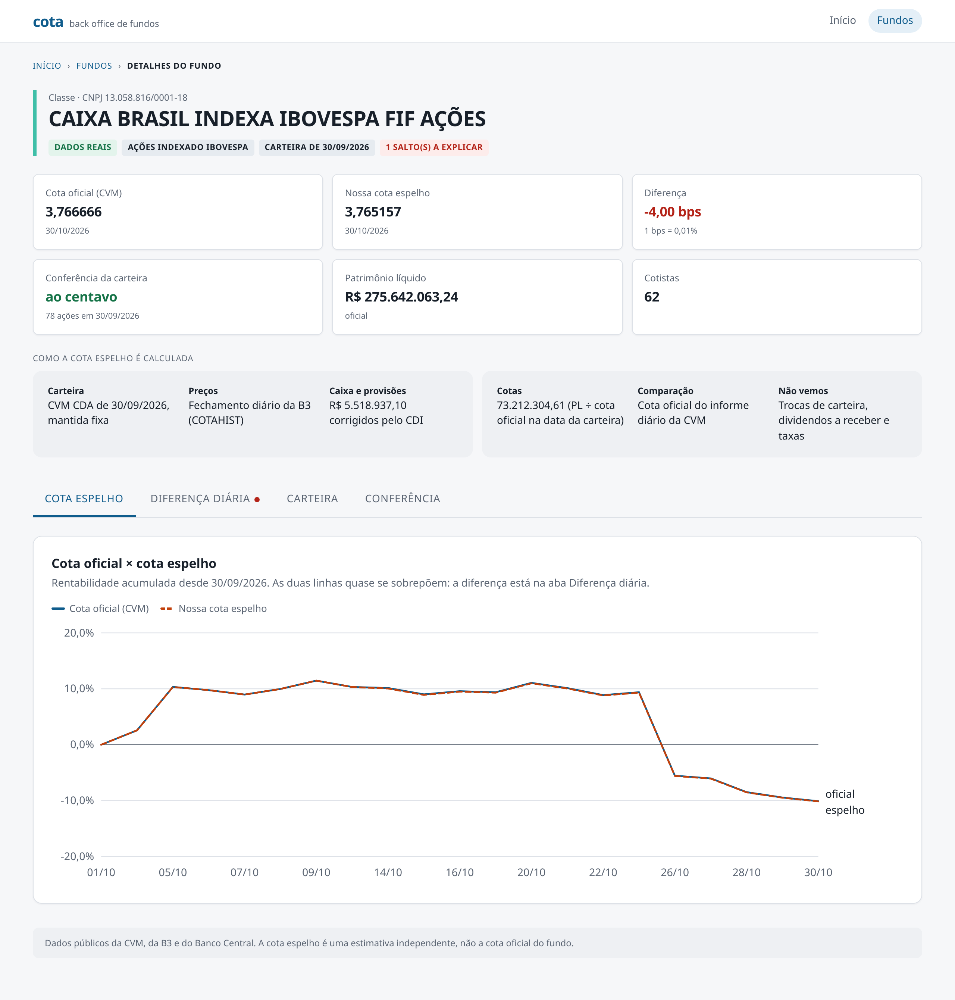
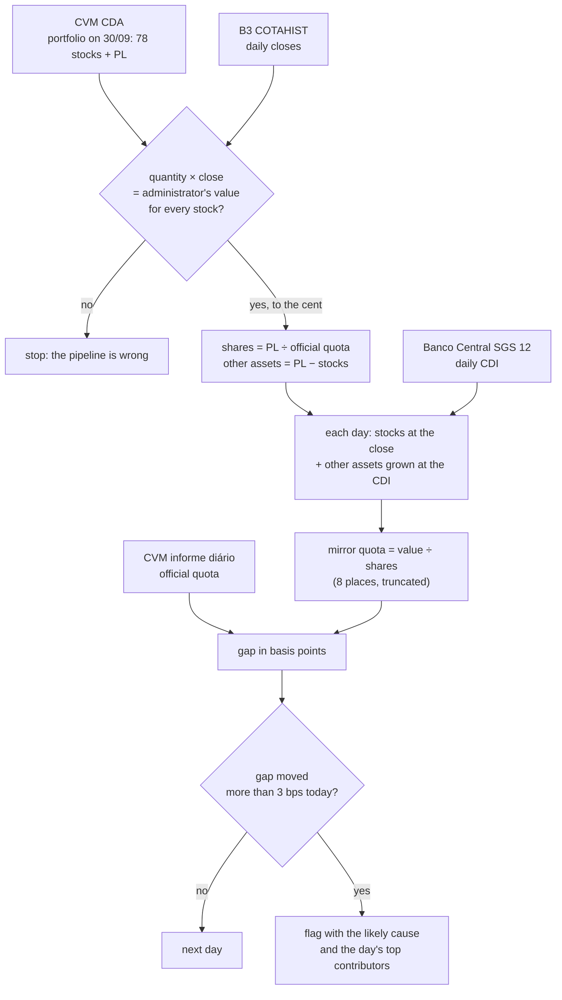
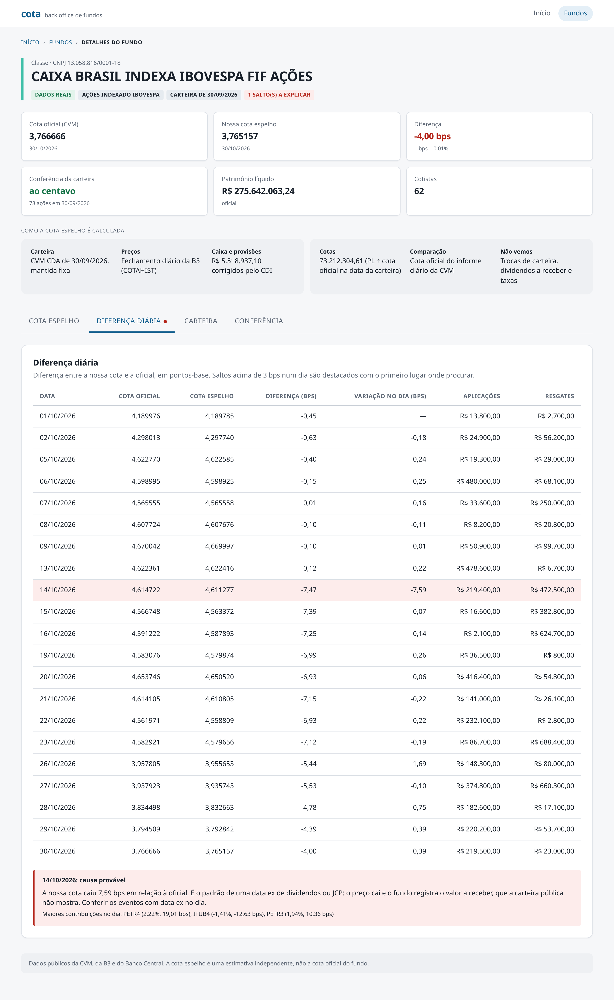
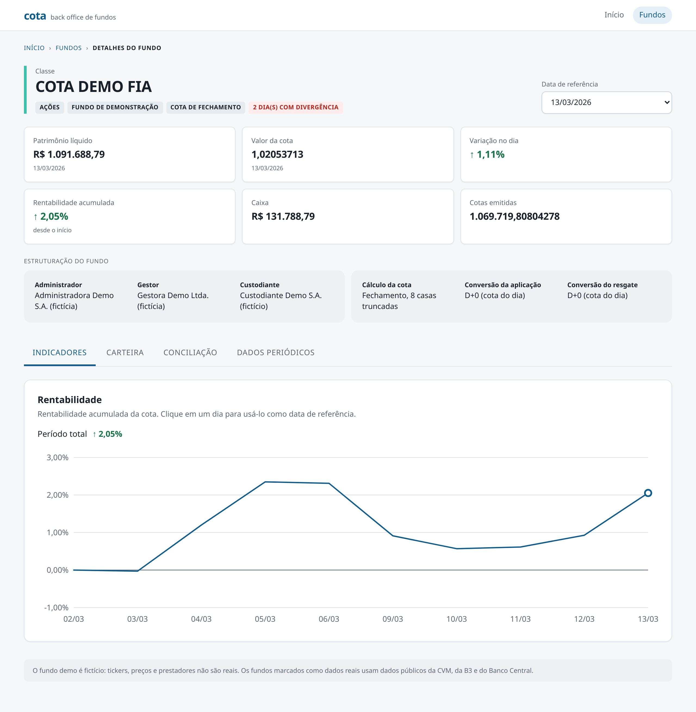
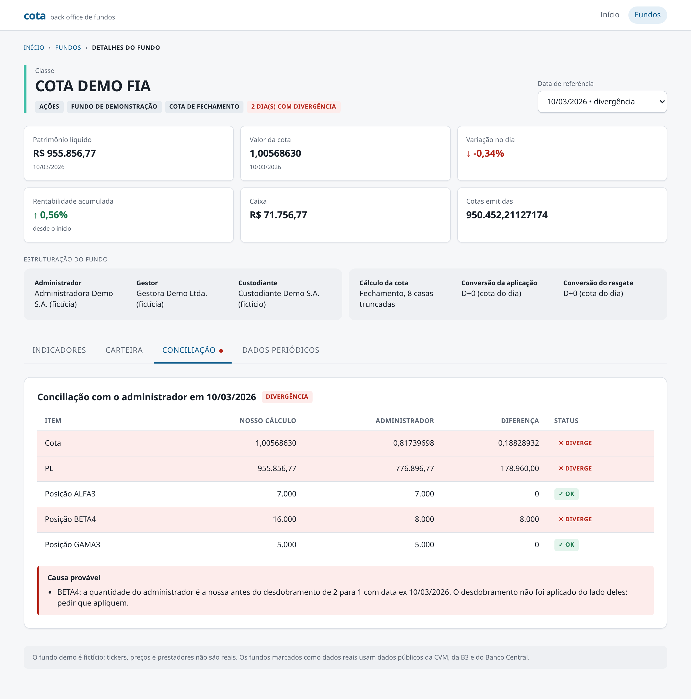
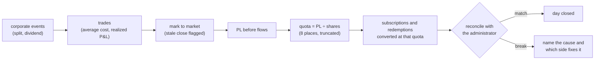
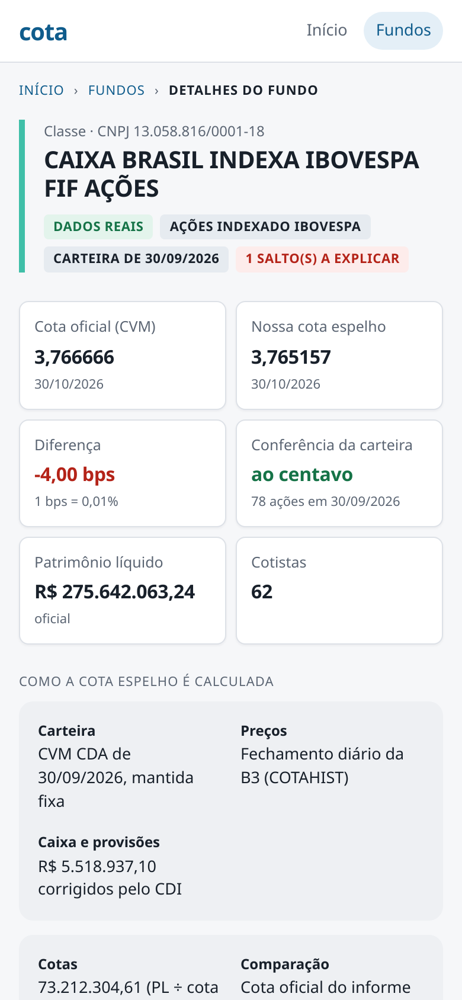

# cota

The daily back office of an investment fund in Python with exact `Decimal`
arithmetic, a FastAPI service and a React + TypeScript screen. It does two things:

1. **Mirror quota of a real fund.** From public data only (CVM, B3, Banco
   Central), it rebuilds the daily quota of *CAIXA Brasil Indexa Ibovespa* and
   compares it with the official quota the administrator published. In October
   2026 the mirror stayed within 1 basis point of the official quota until an
   ex-dividend day, and every gap is explained on screen.
2. **Fund ledger with reconciliation**, on a fictional fund: trades, splits,
   dividends and investor flows replayed day by day, quota computed, and every
   figure reconciled with an administrator file that has two planted breaks.



## Mirror quota of a real fund

[`cota/mirror.py`](cota/mirror.py), data from
[`scripts/fetch_real.py`](scripts/fetch_real.py) (`make real`):

| Input | Source |
|---|---|
| Portfolio on 30/09/2026: 78 stocks with quantity and market value, and the PL | CVM CDA (`cda_fi_BLC_4`, `cda_fi_PL`) |
| Official daily quota, PL, subscriptions, redemptions, holders | CVM informe diário |
| Daily close of each stock | B3 COTAHIST |
| Daily CDI | Banco Central SGS 12 |

How it reasons, in order:



1. **Check the pipeline before trusting it.** On the portfolio date, quantity ×
   B3 close must equal the market value the administrator reported, stock by
   stock. It does, to the cent: R$ 299,852,513.91 on both sides.
2. **Rebuild the quota.** Hold the disclosed portfolio, price it at each day's
   close, grow the non-stock part (cash, receivables, payables) at the CDI, and
   divide by the shares outstanding implied on the portfolio date (PL ÷ quota).
   Investor flows do not move the quota of an index fund that invests them pro
   rata, so they need no modelling.
3. **Explain the gap, do not hide it.** The gap stayed between −0.6 and +0.1 bps
   for nine days. On 14/10 it jumped by −7.6 bps in one day and stayed there:
   the pattern of an ex-dividend/JCP date, when the price drops and the fund
   books a receivable the public portfolio does not show. Jumps above 3 bps are
   flagged with that reading and the stocks that moved the portfolio most.



What the mirror cannot see, and so where the remaining gap comes from: trades
after the portfolio date (the index rebalances), receivables from dividends,
and the fund's fees. A longer run would separate the fee as a steady daily drift.

The extract is not committed: run `make real` (≈150 MB of public files, cached
in `~/.cache/cota/raw`), then `make run` and open **Fundos**.

## Fund ledger with reconciliation (demo fund)



The screen is a fund page in the style of public fund portals: headline figures
for a reference date, the fund's structure, and four tabs: **Indicadores** (the
quota's accumulated return; click a day to make it the reference date),
**Carteira** (positions), **Conciliação** (against the administrator) and
**Dados periódicos** (daily PL, quota, subscriptions and redemptions).



## Why

In Brazil the administrator computes the official quota and the manager checks it
every day. When the two numbers disagree, someone has to find out why before the
quota is published: a split one side missed, a price that never arrived, a trade
booked twice. This project models that loop end to end and makes the explanation
part of the output, not something done by hand in a spreadsheet.

## Ledger: order of operations

Each day, in this order (see [`cota/ledger.py`](cota/ledger.py)):



1. **Corporate events** with that ex-date: a split multiplies the quantity and
   divides the average cost; a dividend credits cash.
2. **Trades**: buys update the average cost (fees included); sells realize profit
   or loss against it and never change it.
3. **Mark to market** with the day's close. A missing close falls back to the
   previous one and the position is flagged as stale instead of silently priced.
4. **Net asset value (PL)** = cash + market value, before the day's investor
   flows. **Quota** = PL ÷ shares outstanding, truncated to 8 places; the first
   quota is 1.
5. **Subscriptions and redemptions** are converted into shares at that quota.

Then [`cota/reconcile.py`](cota/reconcile.py) compares the quota (tolerance of
one unit in the 8th place), the PL (one cent) and every position (exact) with the
administrator's file, and names the likely cause of each break and which side has
to fix it.

### Money rules

- No floats anywhere on the money path: CSV values are parsed straight into
  `Decimal`, and the API returns decimals as strings so JSON cannot round them.
  The web app formats those strings without turning them into numbers.
- Currency amounts round to cents half to even; the quota and shares are
  truncated to 8 places.
- Selling more than the fund holds, or redeeming more shares than exist, is an
  error, not a negative position.

## The demo fund

[`data/demo/`](data/demo) holds two weeks of a fictional fund (tickers and prices
are made up) generated by [`scripts/make_demo.py`](scripts/make_demo.py). The
administrator's file is the engine's own result with two planted breaks:

| Day | Break | Explained as |
|---|---|---|
| 10/03/2026 | Administrator's BETA4 quantity is half of ours | 2-for-1 split not applied on their side |
| 12/03/2026 | Quota and PL differ, positions match | GAMA3 close missing on our side, marked at the day before |


## The screen

React + TypeScript, no UI library. A fund page in the style of public fund
portals with an app bar, breadcrumbs (Início, Fundos, fund) and links that open
a tab on a given day (`#/fundos/demo?aba=conciliacao&dia=2026-03-10`). Light and
dark themes follow the system. Breakpoints at 1360, 860, 600 and 380 px: the
headline figures go from six columns to three and then two, the structure panels
stack, tables scroll sideways with the first column pinned, and charts keep a
readable width.



## Run it

Needs Python 3.11+ and Node 20+.

```sh
make setup      # .venv with dev tools, web packages
make check      # ruff, mypy --strict, pytest, vitest
make real       # optional: public data for the mirror quota (~150 MB)
make run        # API and the built app on http://127.0.0.1:8000
```

For development, `make dev` serves the API on :8000 and `cd web && npm run dev`
serves the app on :5173 with `/api` proxied.

API: `GET /api/real`, `GET /api/real/{slug}`, `GET /api/fund`, `GET /api/days`, `GET /api/portfolio/{date}`, `GET /api/reconciliation/{date}`.
Point `COTA_DATA_DIR` at another folder with the same five CSV files and a `fund.json` to run your
own data.

## Tests

- [`tests/test_mirror.py`](tests/test_mirror.py): the B3 fixed-width parser,
  SGS dates, the pipeline check, the mirror quota against hand-computed values,
  a missing close, cash growing at the CDI, and the jump explanation.
- [`tests/test_ledger.py`](tests/test_ledger.py): hand-computed cases for average
  cost with fees, quota truncation, realized profit, splits keeping the value,
  dividends moving value from stock to cash, flows converting at the day's quota,
  stale prices, and overselling.
- [`tests/test_reconcile_and_api.py`](tests/test_reconcile_and_api.py): the demo
  breaks on exactly the two planted days with the right causes, tolerance, and
  the API returning decimals as strings.
- [`web/src/format.test.ts`](web/src/format.test.ts): Brazilian number formatting
  of decimal strings without precision loss.

CI runs all of it on Python 3.11 and 3.13 and checks that the demo data
regenerates byte for byte.

## Not modelled (yet)

Management and performance fees, taxes (come-cotas), fixed income and
derivatives, settlement dates (D+1/D+2) and redemption quota dates, multiple
share classes. The order of operations and the reconciliation are where these
would plug in.

## License

MIT
