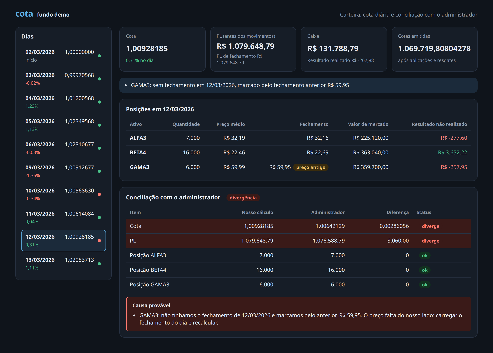

# cota

The daily back-office loop of an investment fund, small enough to read in one
sitting: replay trades, corporate events and investor flows, mark the portfolio
to market, compute the net asset value and the **quota** (the fund's unit price),
then **reconcile** every figure with the fund administrator and explain each
break. Python with exact `Decimal` arithmetic, a FastAPI service and a React +
TypeScript screen.


## Why

In Brazil the administrator computes the official quota and the manager checks it
every day. When the two numbers disagree, someone has to find out why before the
quota is published: a split one side missed, a price that never arrived, a trade
booked twice. This project models that loop end to end and makes the explanation
part of the output, not something done by hand in a spreadsheet.

## What it does

Each day, in this order (see [`cota/ledger.py`](cota/ledger.py)):

1. **Corporate events** with that ex-date: a split multiplies the quantity and
   divides the average cost; a dividend credits cash.
2. **Trades**: buys update the average cost (fees included); sells realize profit
   or loss against it and never change it.
3. **Mark to market** with the day's close. A missing close falls back to the
   previous one and the position is flagged as stale instead of silently priced.
4. **Net asset value (PL)** = cash + market value, before the day's investor
   flows. **Quota** = PL ÷ shares outstanding, truncated to 8 places; the first
   quota is 1.
5. **Subscriptions and redemptions** are converted into shares at that quota.

Then [`cota/reconcile.py`](cota/reconcile.py) compares the quota (tolerance of
one unit in the 8th place), the PL (one cent) and every position (exact) with the
administrator's file, and names the likely cause of each break and which side has
to fix it.

### Money rules

- No floats anywhere on the money path: CSV values are parsed straight into
  `Decimal`, and the API returns decimals as strings so JSON cannot round them.
  The web app formats those strings without turning them into numbers.
- Currency amounts round to cents half to even; the quota and shares are
  truncated to 8 places.
- Selling more than the fund holds, or redeeming more shares than exist, is an
  error, not a negative position.

## The demo fund

[`data/demo/`](data/demo) holds two weeks of a fictional fund (tickers and prices
are made up) generated by [`scripts/make_demo.py`](scripts/make_demo.py). The
administrator's file is the engine's own result with two planted breaks:

| Day | Break | Explained as |
|---|---|---|
| 10/03/2026 | Administrator's BETA4 quantity is half of ours | 2-for-1 split not applied on their side |
| 12/03/2026 | Quota and PL differ, positions match | GAMA3 close missing on our side, marked at the day before |



## Run it

Needs Python 3.11+ and Node 20+.

```sh
make setup      # .venv with dev tools, web packages
make check      # ruff, mypy --strict, pytest, vitest
make run        # API and the built app on http://127.0.0.1:8000
```

For development, `make dev` serves the API on :8000 and `cd web && npm run dev`
serves the app on :5173 with `/api` proxied.

API: `GET /api/days`, `GET /api/portfolio/{date}`, `GET /api/reconciliation/{date}`.
Point `COTA_DATA_DIR` at another folder with the same five CSV files to run your
own data.

## Tests

- [`tests/test_ledger.py`](tests/test_ledger.py): hand-computed cases for average
  cost with fees, quota truncation, realized profit, splits keeping the value,
  dividends moving value from stock to cash, flows converting at the day's quota,
  stale prices, and overselling.
- [`tests/test_reconcile_and_api.py`](tests/test_reconcile_and_api.py): the demo
  breaks on exactly the two planted days with the right causes, tolerance, and
  the API returning decimals as strings.
- [`web/src/format.test.ts`](web/src/format.test.ts): Brazilian number formatting
  of decimal strings without precision loss.

CI runs all of it on Python 3.11 and 3.13 and checks that the demo data
regenerates byte for byte.

## Not modelled (yet)

Management and performance fees, taxes (come-cotas), fixed income and
derivatives, settlement dates (D+1/D+2) and redemption quota dates, multiple
share classes. The order of operations and the reconciliation are where these
would plug in.

## License

MIT
